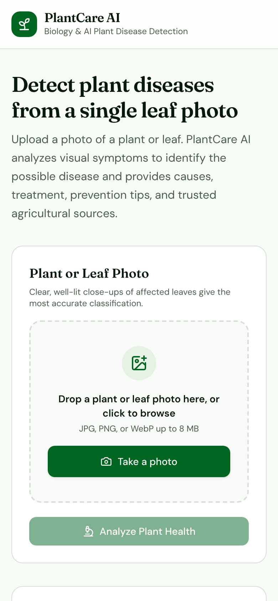

# PlantCare AI

A web app that looks at a photo of a plant or leaf and returns a structured disease report:
the likely species, health status, disease, symptoms, causes, treatment, prevention tips and
links to trusted agricultural sources.


## What it does

1. You upload or drag in a JPG, PNG or WebP photo (up to 8 MB).
2. The browser checks the file and resizes it to at most 1280 px before sending it.
3. A server function validates the image again and sends it to a vision model
   (OpenAI Responses API) with a **strict JSON schema**, so the answer always has the same fields.
4. The response is validated with **Zod**. If the photo is not a plant, the app says so instead of guessing.
5. Source links are filtered against an **allowlist of agricultural domains** (UC IPM, APS, FAO, USDA,
   RHS, Cornell, EPPO, PlantVillage and others). Any other link is dropped, and two known-good
   references are added if fewer than two remain.
6. The report shows severity and confidence so uncertain results are clearly marked.

## How it is built

```
src/
├── routes/index.tsx                upload page, drag and drop, image resizing
├── components/DiagnosisReport.tsx  report layout
├── lib/
│   ├── plant-diagnosis.ts          schema, file checks, size limits, source allowlist
│   ├── analyze-plant.functions.ts  server function: input validation
│   └── analyze-plant.server.ts     OpenAI call with a strict JSON schema
└── test/                           unit and routing tests (Vitest)
```

- **Frontend:** React 19, TypeScript, Tailwind CSS v4, TanStack Router
- **Server:** TanStack Start server functions; the API key stays on the server
- **Validation:** Zod on both the request and the AI response
- **Quality:** ESLint + Prettier, Vitest, GitHub Actions CI (lint, type check, tests, build)

## Run it locally

Requires Node.js 20.19 or newer and an OpenAI API key.

```bash
npm install
cp .env.example .env      # then put your key in .env
npm run dev
```

| Variable | Required | Default |
|---|---|---|
| `OPENAI_API_KEY` | yes | none |
| `OPENAI_MODEL` | no | `gpt-4o-mini` |

`.env` is git-ignored, so your key is never committed.

## Install on your phone

PlantCare AI is an installable web app (PWA): a web app manifest, 192/512 px and maskable icons, and a small
service worker (`public/sw.js`). On a phone, the **Take a photo** button opens the rear camera directly.

- **Android (Chrome):** menu → *Add to Home screen* / *Install app*.
- **iPhone (Safari):** Share → *Add to Home Screen*.

The app needs a secure origin (https or `localhost`) and a production build (`npm run build`, then `npm run preview`);
the service worker is only registered in production builds. Offline, pages you already opened still load and any other
page shows an offline message; analysing a photo always needs the internet because it calls the AI. I checked the
manifest, service-worker registration, offline fallback and phone layout (390 px) in Chromium; I did not test on a
physical phone, so the install steps above are unverified on real devices.



## Scripts

| Command | What it does |
|---|---|
| `npm run dev` | Start the development server |
| `npm test` | Run the Vitest test suite |
| `npm run lint` | ESLint + Prettier checks |
| `npm run build` | Production build |

## Limitations

- The diagnosis comes from a general vision model, not a model trained on a plant-disease dataset.
  It is a study and triage aid, not a replacement for a plant pathologist or extension service.
- Each analysis is a paid API call to OpenAI.
- Results depend on photo quality: one clear leaf in good light works best.

## Author

Zainab Alameri ([@Zalameri](https://github.com/Zalameri)), Computer Science & AI student at Effat University.

## Portfolio

Full case study: <https://zalameri.github.io/project.html?p=plantcare-ai>
